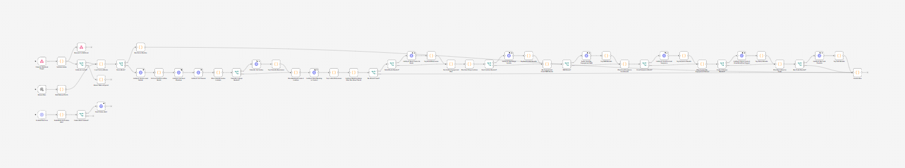

# n8n-hubspot-meeting-no-show-re-engagement-pipeline

> DISCLAIMER.md · Licensed under the MIT License. License: MIT © 2026 dhRobin Systems · Provided as-is, see the disclaimer.

An n8n workflow that turns a missed meeting into a same-day recovery play. When a meeting is marked **No-Show**, either by the rep in HubSpot (meeting outcome) or by a Calendly webhook, it:

1. **Confirms the no-show.** It checks the HubSpot meeting outcome, or matches the Calendly invitee to a HubSpot contact.
2. **Updates the deal stage.** It moves the associated open deal to your "no-show / re-engage" stage, and never moves a later-stage deal backwards.
3. **Routes the re-engagement.** It picks SMS or email for each contact. SMS needs explicit consent, a usable mobile number and allowed sending hours; email respects the opt-out. A cooldown stops repeat messages.
4. **Creates a rep task.** Every no-show gets a high-priority follow-up task for the rep, with the context already written.

I built it because no-shows are a pipeline leak that is cheap to fix but rarely fixed consistently. A message that goes out within minutes, a deal stage that reflects reality and a task the rep cannot miss recover a meaningful share of missed meetings.

Out of the box it is **offline and silent**:

- While `HUBSPOT_PRIVATE_APP_TOKEN` is a placeholder, it runs against bundled fictional records (Acme Corp, Example Company Inc.). Every phone number is in the reserved 555-0100 to 555-0199 range, and HubSpot, Calendly and Twilio are mocked.
- `DRY_RUN=true` and `SANDBOX_MODE=true` stay on unless they are explicitly set to `false`, and `SMS_PROVIDER=none` is the default.

---

## Contents

1. [Architecture overview](#architecture-overview)
2. [Decision rules](#decision-rules)
3. [Safety model](#safety-model)
4. [Prerequisites](#prerequisites)
5. [Environment variables](#environment-variables)
6. [Setup in HubSpot](#setup-in-hubspot)
7. [Setup in Calendly (optional)](#setup-in-calendly-optional)
8. [Setup in n8n](#setup-in-n8n)
9. [Step-by-step activation](#step-by-step-activation)
10. [Node reference](#node-reference)
11. [Error handling and maintenance](#error-handling-and-maintenance)
12. [CLI, tests and lint](#cli-tests-and-lint)
13. [Repository layout](#repository-layout)
14. [Limits and what I could not verify](#limits-and-what-i-could-not-verify)
15. [Disclaimer and license](#️-disclaimer--liability-limitation)

---

## Architecture overview



```
HubSpot meeting workflow ("Meeting outcome changed") ─┐
Calendly webhook (invitee_no_show.created) ───────────┴─▶ Calendar Webhook Trigger ─▶ Validate Intake ─┬─▶ Respond to Webhook
                                                                                                    └─▶ Intake Accepted? ─no─▶ Raise If Misconfigured
Manual Run ─▶ Build Manual Batch ─────────────────────────────────────────────┐ yes
                                                                              ▼
                        Load Config & Route ─▶ Demo Mode? ─yes─▶ Run Demo Pipeline ───────────────────────────────────────┐
                                                     │ no                                                                 │
  HubSpot: Get Account Details ▶ Enforce Sandbox ▶ HubSpot: Get Deal Pipelines ▶ HubSpot: List Owners                     │
  ▶ Plan Calendly Invitee Lookups ▶ (Calendly: Get Invitee) ▶ Plan Meeting & Contact Lookups                              │
  ▶ HubSpot: Read Meeting or Contact ▶ HubSpot Meeting Status Filter (No-Show Check) ▶ No-Shows Found? ─no──▶ Finalize    │
  ▶ HubSpot: Read Contact & Deals ▶ Decide Re-Engagement Plan                                                              │
  ▶ Plan Deal Stage Updates ▶ HubSpot: Deal Stage Update                                                                   │
  ▶ Re-Engagement Email/SMS Router ▶ Twilio: Send Re-Engagement SMS                                                        │
  ▶ Plan Email Sequence Enrollments ▶ HubSpot: Enroll in Email Sequence          (EMAIL_PROVIDER=hubspot_sequence)        │
  ▶ Plan Contact Re-Engagement Stamps ▶ HubSpot: Stamp Contact (Email Workflow Trigger)                                    │
  ▶ Plan Rep Follow-Up Tasks ▶ HubSpot: Rep Task Creation                                                                  │
  ▶ Finalize Run ◀──────────────────────────────────────────────────────────────────────────────────────────────────────┘

On Workflow Error ▶ Build Redacted Failure Alert ▶ Failure Alert Enabled? ▶ Send Failure Alert
```

- **One endpoint, two sources.**
  - HubSpot calls carry the meeting ID and a shared-secret header.
  - Calendly calls are signed with `Calendly-Webhook-Signature`, and the intake verifies the HMAC and timestamp. If a no-show payload carries only the invitee URI, the invitee's email is read from the Calendly API.
- **HubSpot is the source of truth.** The workflow reads the meeting with its contact and deal associations, the contact (consent, opt-out, phone, cooldown), the deals and the pipeline stage order.
- **Plan, then execute.** Each write stage is a Code node that plans requests followed by an HTTP Request node that executes them. Under `DRY_RUN` the planners return nothing, so the write nodes never run.
- **One codebase.** All logic lives in `src/core/*.js`, and `scripts/build-workflow.js` embeds it into `workflow.json`. The Node.js mirror (`src/core/pipeline.js`) runs the same functions in the same order. The tests run the generated workflow in a simulator and require the same final HubSpot, Twilio and task state as the mirror.

---

## Decision rules

### No-show check

| Source | Counts as a no-show when… | Skipped as… |
|---|---|---|
| HubSpot meeting | `hs_meeting_outcome` is in `NO_SHOW_OUTCOME_VALUES` (default `NO_SHOW`) and a contact is associated | `outcome_completed`, `outcome_rescheduled`, `no_associated_contact`, `meeting_not_readable` |
| Calendly | `invitee_no_show.created`, and the invitee email matches a HubSpot contact | `contact_not_in_hubspot`, `calendly_invitee_email_unknown` |

`invitee_no_show.deleted` (a no-show mark removed) is acknowledged and counted, and nothing is sent. When a meeting has several contacts, the first is re-engaged automatically and the rep task names the others.

### Deal stage update

- **Which deal:** the newest **open** associated deal (`DEAL_SELECTION=most_recent`), or every open one (`all`). Closed deals are never touched.
- **Target stage:** set per pipeline with `NO_SHOW_DEAL_STAGE_MAP`, for example `{"default":"YOUR_NO_SHOW_DEAL_STAGE_ID"}`. Pipelines without an entry are left alone.
- **Never backwards:** a deal already past the no-show stage (for example in Contract Sent) is **not** moved back, unless `ALLOW_BACKWARD_STAGE_MOVES=true`. Deals already in the stage are left as they are.

### Re-engagement router

For each contact, the router walks `CHANNEL_PRIORITY` (default `sms,email`) and takes the first eligible channel. Set `SEND_BOTH_CHANNELS=true` to send on every eligible channel.

| Channel | Eligible only when |
|---|---|
| SMS | `SMS_PROVIDER=twilio`, the consent property (`SMS_CONSENT_PROPERTY`) is `true`, the mobile or phone number normalises to E.164, the hour in `SMS_TIMEZONE` is inside `SMS_ALLOWED_HOURS`, and in sandbox mode `SMS_SANDBOX_RECIPIENT` is set (every sandbox SMS goes there) |
| Email | `EMAIL_PROVIDER` is not `none`, the contact has an email, and `EMAIL_OPT_OUT_PROPERTY` (`hs_email_optout`) is not `true` |

- **Cooldown:** a contact re-engaged within `REENGAGEMENT_COOLDOWN_DAYS` (7) gets no automated message, only the rep task.
- **Email delivery** has two options:
  - **`hubspot_workflow` (default, recommended).** The pipeline stamps the contact with `no_show_reengagement_status = email_triggered`. A HubSpot contact workflow triggered by that value sends your marketing emails, so HubSpot enforces subscription types and unsubscribes.
  - **`hubspot_sequence`.** The contact is enrolled in `HUBSPOT_SEQUENCE_ID` on behalf of the meeting owner (Sales Hub sequences).

### Contact stamp and rep task

- **Stamp:** each no-show writes `no_show_reengagement_status`, `no_show_last_reengaged_at` (when a channel was used) and an incremented `no_show_count`.
- **Task:** one **HIGH priority** task per no-show, due in `TASK_DUE_HOURS` (2), associated with the contact (type 204) and the deal (type 216).
  - It is assigned to the meeting owner, then the deal owner, then the contact owner, then `FALLBACK_TASK_OWNER_ID`.
  - The body says what was missed, which message went out (or why none did), what happened to the deal, and the rebooking link.

---

## Safety model

| Layer | Default | Effect |
|---|---|---|
| Demo mode | on while the token is a placeholder | Fictional records, mock HubSpot, Calendly and Twilio, no network |
| `DRY_RUN` | `true` | Every decision is made and reported. No deal update, SMS, sequence enrollment, contact stamp or task. |
| `SANDBOX_MODE` | `true` | Checks `/account-info/v3/details` and stops unless the portal is `SANDBOX` or `DEVELOPER_TEST`, or matches `HUBSPOT_SANDBOX_PORTAL_ID`. **Every SMS is redirected to `SMS_SANDBOX_RECIPIENT`**; without one, no SMS is sent. |
| `SMS_PROVIDER` | `none` | No SMS until Twilio is configured on purpose |
| Live-mode lock | | When `DRY_RUN=false` and `SANDBOX_MODE=false`, the workflow refuses to start with a placeholder token |
| Consent and quiet hours | | SMS only with explicit consent, inside `SMS_ALLOWED_HOURS` in `SMS_TIMEZONE`. Email respects the opt-out property. |
| Cooldown | 7 days | At most one automated re-engagement per contact per window |
| Webhook authentication | | Shared secret (constant time, at least 24 characters) or Calendly HMAC with a 5-minute timestamp window. Wrong credentials get `401`. Misconfiguration gets `503` and fails the execution, so the error branch alerts. |
| Replay protection | 7 days | Event keys (meeting ID or Calendly no-show URI) are remembered in static data |
| No credentials in the export | | The HubSpot, Calendly and Twilio credentials and the Twilio account SID are read from `$env` inside HTTP expressions. No node stores credentials, and successful executions are not saved. |
| Redacted failure alerts | | Tokens, Basic auth, Twilio SIDs, webhook URLs, phone numbers and email addresses are removed |

---

## Prerequisites

- **n8n** 1.x (self-hosted, or any plan with environment variables), with these nodes: Webhook v2, Respond to Webhook v1.1, Code v2, IF v2, HTTP Request v4.2 and Error Trigger.
- **n8n host settings:**
  - `N8N_BLOCK_ENV_ACCESS_IN_NODE=false`, so Code nodes and expressions can read `$env`
  - `NODE_FUNCTION_ALLOW_BUILTIN=crypto`, so the intake node can verify Calendly signatures
- **HubSpot:**
  - meeting outcomes in use, with "No show" enabled in the call and meeting outcome settings
  - meeting-based workflows available in your portal
  - a private app with read access to meetings, contacts, deals and owners, write access to deals, contacts and tasks, and the sequences scope only for `EMAIL_PROVIDER=hubspot_sequence`. Check the exact scope names in the private app's scope list.
- **Optional:**
  - Calendly on a paid plan, with a webhook subscription and a personal access token
  - a Twilio account with a registered sending number or Messaging Service (for example A2P 10DLC registration for US numbers)
- **Node.js 20+** for the CLI, tests and lint. There are no npm dependencies.

---

## Environment variables

| Variable | Default | Purpose |
|---|---|---|
| `HUBSPOT_PRIVATE_APP_TOKEN` | `YOUR_HUBSPOT_PRIVATE_APP_TOKEN` | Private app token. A placeholder means demo mode. |
| `HUBSPOT_BASE_URL` / `HUBSPOT_SANDBOX_PORTAL_ID` | `https://api.hubapi.com` / placeholder | API base URL, and a portal `SANDBOX_MODE` also accepts |
| `NO_SHOW_OUTCOME_VALUES` | `NO_SHOW` | Outcome internal values that count as a no-show |
| `DRY_RUN` / `SANDBOX_MODE` | `true` / `true` | Safety switches |
| `WEBHOOK_SECRET` / `WEBHOOK_SECRET_HEADER` | `YOUR_WEBHOOK_SECRET` / `x-webhook-secret` | HubSpot workflow authentication |
| `CALENDLY_WEBHOOK_SIGNING_KEY` | `YOUR_CALENDAR_WEBHOOK_SECRET` | Calendly signature verification |
| `CALENDLY_API_TOKEN` | placeholder | Resolves invitee emails when a no-show payload carries only the URI |
| `WEBHOOK_MAX_AGE_MINUTES` / `MAX_EVENTS_PER_REQUEST` / `EVENT_DEDUPE_DAYS` | `5` / `50` / `7` | Signature window, batch cap, replay window |
| `NO_SHOW_DEAL_STAGE_MAP` | `{"default":"YOUR_NO_SHOW_DEAL_STAGE_ID"}` | Pipeline ID → no-show stage ID |
| `DEAL_SELECTION` / `ALLOW_BACKWARD_STAGE_MOVES` / `MAX_DEALS_PER_EVENT` | `most_recent` / `false` / `10` | Deal policy |
| `CHANNEL_PRIORITY` / `SEND_BOTH_CHANNELS` / `REENGAGEMENT_COOLDOWN_DAYS` | `sms,email` / `false` / `7` | Router |
| `SMS_CONSENT_PROPERTY` / `EMAIL_OPT_OUT_PROPERTY` | `sms_marketing_consent` / `hs_email_optout` | Consent and opt-out properties |
| `REBOOKING_URL` | `YOUR_REBOOKING_URL` | Link used in the SMS template and the task |
| `EMAIL_PROVIDER` / `HUBSPOT_SEQUENCE_ID` | `hubspot_workflow` / placeholder | Email channel |
| `SMS_PROVIDER` | `none` | `none` or `twilio` |
| `TWILIO_ACCOUNT_SID` / `TWILIO_AUTH_TOKEN` | placeholders | Twilio credentials, used only from `$env` |
| `TWILIO_FROM_NUMBER` / `TWILIO_MESSAGING_SERVICE_SID` | placeholders | Sender (one of the two) |
| `SMS_SANDBOX_RECIPIENT` | `YOUR_SMS_SANDBOX_RECIPIENT` | Test number that receives every sandbox SMS |
| `SMS_TIMEZONE` / `SMS_ALLOWED_HOURS` / `SMS_DEFAULT_COUNTRY_CODE` | `America/New_York` / `9-20` / `1` | Quiet hours and number normalisation |
| `SMS_TEMPLATE` | see `.env.example` | Supports `{{firstName}}`, `{{rebookUrl}}`, `{{meetingTitle}}` |
| `REENGAGEMENT_STATUS_PROPERTY` / `REENGAGEMENT_TIMESTAMP_PROPERTY` / `NO_SHOW_COUNT_PROPERTY` | `no_show_reengagement_status` / `no_show_last_reengaged_at` / `no_show_count` | Contact stamp properties |
| `CREATE_REP_TASKS` / `TASK_DUE_HOURS` / `FALLBACK_TASK_OWNER_ID` | `true` / `2` / placeholder | Rep task |
| `ALERT_WEBHOOK_URL` | `YOUR_ALERT_WEBHOOK_URL` | Optional HTTPS endpoint (for example Slack) for redacted failure alerts |
| `MANUAL_TEST_MEETING_IDS` | placeholder | Meetings that **Manual Run** processes in HubSpot mode |
| `PIPELINE_NOW` | empty | Testing only: pins the clock |

---

## Setup in HubSpot

1. **Create the properties.** Run `npm run properties:create` with your sandbox token. It prints the four payloads; run it again with `DRY_RUN=false` to create them. The properties are:
   - `no_show_reengagement_status`: a dropdown with `email_triggered`, `sms_sent`, `sequence_enrolled`, `skipped_cooldown` and `skipped_no_channel`
   - `no_show_last_reengaged_at`: date-time
   - `no_show_count`: number
   - `sms_marketing_consent`: a checkbox. Skip this one if you already store SMS consent elsewhere, and point `SMS_CONSENT_PROPERTY` at your property instead.
2. **Create the no-show stage.** Add a "Meeting No-Show (Re-engage)" stage to each pipeline. Its internal ID appears under *Settings → Objects → Deals → Pipelines → edit stage*. Put the IDs in `NO_SHOW_DEAL_STAGE_MAP`.
3. **Create the meeting-based workflow that calls n8n.** Go to *Automation → Workflows → Create workflow → From scratch*, and choose **Meeting** as the object.
   - Enrollment trigger: **Meeting outcome changed**, filtered to outcome is **No show**. Turn re-enrollment on.
   - Action: **Send a webhook**, method `POST`, to the n8n production URL `https://<your-n8n-host>/webhook/meeting-no-show`.
   - Authentication: API key in the request header, with the key name `x-webhook-secret` and the value `WEBHOOK_SECRET`.
   - Request body: include the meeting **Record ID**. The pipeline accepts `objectId`, `hs_object_id` or `meetingId`.
4. **Create the email workflow** (when `EMAIL_PROVIDER=hubspot_workflow`). Create a contact-based workflow:
   - Trigger: `no_show_reengagement_status` **is** `email_triggered`, with re-enrollment on.
   - Actions: send your rebooking marketing email (for example "Missed the call? Pick a new time"), then a follow-up after two days if no meeting is booked.
   - HubSpot applies subscription types, unsubscribes and send-time rules. Marketing email in workflows needs Marketing Hub Professional or higher. Without it, use `hubspot_sequence` (Sales Hub) or rely on the rep task.

---

## Setup in Calendly (optional)

1. **Create a personal access token** in Calendly under *Integrations → API & Webhooks*. Set it as `CALENDLY_API_TOKEN`.
2. **Create a webhook subscription** through the Calendly API (`POST https://api.calendly.com/webhook_subscriptions`):
   - `url`: the n8n production URL
   - `events`: `["invitee_no_show.created", "invitee_no_show.deleted"]`
   - your organization or user scope
   - a `signing_key` of your choice. Set the same value as `CALENDLY_WEBHOOK_SIGNING_KEY`.
3. **Mark no-shows in Calendly** as usual. Each mark sends a signed request. The invitee email is matched to a HubSpot contact by email, and invitees not in HubSpot are skipped and counted.

---

## Setup in n8n

1. **Set the host settings and variables.** Set `N8N_BLOCK_ENV_ACCESS_IN_NODE=false` and `NODE_FUNCTION_ALLOW_BUILTIN=crypto`, add the variables from `.env.example`, and restart n8n.
2. **Import `workflow.json`.** Use *Workflows → Import from File*. It imports **inactive** and has no credentials to map, because every request reads its keys from `$env`.
3. **Set the error workflow.** Under *Workflow Settings → Error Workflow*, select this workflow, or copy the four failure nodes into a dedicated error workflow.
4. **Run the demo.** Run **Manual Run**. With placeholder variables, **Finalize Run** shows the demo: 5 no-shows, 2 deal moves, 2 SMS and 1 email planned, 1 cooldown, 1 contact with no channel and 5 tasks planned, with nothing written.

**Using n8n credentials instead of `$env`.** You can switch the HubSpot nodes to a *Header Auth* credential and the Twilio node to *Basic Auth*. If you do, keep the environment variables set to non-placeholder values so the safety checks still pass.

---

## Step-by-step activation

| Step | Settings | What to check |
|---|---|---|
| 1. Demo | defaults | **Finalize Run** shows the decisions for the fictional records |
| 2. Sandbox dry run | sandbox token, `WEBHOOK_SECRET`, `NO_SHOW_DEAL_STAGE_MAP`, `MANUAL_TEST_MEETING_IDS` | Mark a test meeting **No show** and run **Manual Run**. The decisions match what you expect. |
| 3. Sandbox writes | `DRY_RUN=false` | The deal moves, the contact is stamped, the task appears, and the email workflow enrols the test contact |
| 4. Sandbox SMS | `SMS_PROVIDER=twilio`, Twilio credentials, `SMS_SANDBOX_RECIPIENT` set to your own test phone | The SMS arrives on the test phone only |
| 5. Live webhook | activate the workflow and turn on the HubSpot meeting workflow (and the Calendly subscription) | Real no-shows in the sandbox flow end to end |
| 6. Production | production token, `SANDBOX_MODE=false`, `DRY_RUN=false`, `ALERT_WEBHOOK_URL` | Watch the first day's executions and the tasks created |

---

## Node reference

| Node | Notes |
|---|---|
| **Calendar Webhook Trigger** | `POST /webhook/meeting-no-show`, responds through **Respond to Webhook** (`202` accepted, `200` duplicate or nothing to do, `400`, `401`, `503`) |
| **Validate Intake** | Shared secret or Calendly signature, normalisation and de-duplication |
| **HubSpot: Get Account Details** / **Enforce Sandbox & Plan Reads** | Sandbox check |
| **HubSpot: Get Deal Pipelines** / **HubSpot: List Owners** | Stage order and closed flags; owner user IDs and emails (for sequences) |
| **Calendly: Get Invitee** | Only for payloads without an email, and only `https://api.calendly.com` URIs. Header `=Bearer {{ $env.CALENDLY_API_TOKEN }}`. |
| **HubSpot: Read Meeting or Contact** | `GET /crm/v3/objects/meetings/{id}?properties=hs_meeting_outcome,…&associations=contacts,deals`, or `GET /crm/v3/objects/contacts/{email}?idProperty=email` |
| **HubSpot Meeting Status Filter (No-Show Check)** | Keeps no-shows and plans the contact and deal detail reads |
| **Decide Re-Engagement Plan** | Deal policy, router decision, stamp and task content |
| **HubSpot: Deal Stage Update** | `PATCH /crm/v3/objects/deals/{id}` `{ dealstage }` |
| **Re-Engagement Email/SMS Router** → **Twilio: Send Re-Engagement SMS** | `POST /2010-04-01/Accounts/{ACCOUNT_SID}/Messages.json`. The SID is substituted from `$env` and the Basic auth header is built from `$env`, with a form-encoded body. |
| **HubSpot: Enroll in Email Sequence** | `POST /automation/v4/sequences/enrollments?userId=…`, only with `hubspot_sequence` |
| **HubSpot: Stamp Contact (Email Workflow Trigger)** | `PATCH /crm/v3/objects/contacts/{id}` with the status, timestamp and count |
| **HubSpot: Rep Task Creation** | `POST /crm/v3/objects/tasks`, HIGH priority, associated with the contact and the deal |
| **Finalize Run** | Totals, skip reasons and per-case report (masked numbers), plus 30 days of daily counters in static data. Fails the execution if any write failed. |

The HubSpot reads are batched at 5 per second. All HTTP nodes retry 2 to 3 times, and the write nodes continue on error so one failure never blocks the other actions.

---

## Error handling and maintenance

| Symptom | Meaning | Action |
|---|---|---|
| `401` | Wrong secret, or a stale or invalid Calendly signature | Check the header value or signing key, and the server clock (5-minute window) |
| `503`, plus an alert | Configuration invalid | The alert lists each problem |
| `200` with `duplicates` | A replayed event | Nothing to do |
| Skip reason `outcome_*` | The meeting outcome was changed to something other than a no-show | Expected. The meeting workflow filter should already limit this. |
| `contact_not_in_hubspot` | A Calendly invitee is not a HubSpot contact | Sync Calendly to HubSpot, or create contacts for Calendly bookings |
| Execution fails at **Finalize Run** | A write failed, for example a Twilio error (unregistered number, invalid recipient) or a HubSpot scope problem | The other actions were kept. Fix the cause and act on that contact manually. Re-sending the event is blocked by de-duplication for 7 days, which is deliberate so contacts are never messaged twice. |

**Maintenance notes:**

- **New pipelines.** Add a no-show stage and a `NO_SHOW_DEAL_STAGE_MAP` entry. Pipelines without one are never touched.
- **Templates.** Changes to `SMS_TEMPLATE` take effect on the next run. Keep the opt-out wording that your carrier registration requires.
- **Rotating secrets.** Rotate `WEBHOOK_SECRET` in n8n and in the HubSpot webhook action at the same time. To rotate the Calendly signing key, recreate the subscription with the new key.
- **Changing the logic.** Edit `src/core`, then run `npm run build:workflow` and `npm run verify`, and re-import. Never hand-edit the embedded code in the Code nodes; `npm run check:workflow` detects drift.
- **Upgrading n8n.** Open the Twilio node (raw form body) and the owner pagination settings, check they survived, then run the demo.

---

## CLI, tests and lint

| Command | Purpose |
|---|---|
| `npm run demo` (`-- --json`) | Offline demo |
| `npm run replay -- fixtures/sample-webhook-bodies.json` | Replay saved webhook bodies through the configured environment (state in `data/state.json`) |
| `npm run run:meetings -- 123,456` | Process HubSpot meetings by ID |
| `npm run properties:create` | Create the contact properties (dry run by default) |
| `npm run lint` | Syntax, JSON, license headers, the disclaimer line in every file, secrets, example-only emails, documentation voice |
| `npm test` | 32 tests |
| `npm run check:workflow` / `npm run build:workflow` | Check or regenerate `workflow.json` |

The tests cover:

- **`tests/noshow.test.js`:**
  - configuration safety
  - shared-secret and Calendly-signature intake, event extraction and replay protection
  - the status filter and every deal-policy rule
  - every router rule: consent, quiet hours, sandbox recipient, opt-out, cooldown, both channels, sequences
  - payload builders, dry-run planners and redaction
  - the demo outcomes, sandbox writes, sequence enrollment, sandbox refusal, failed SMS and HTTP retries
- **`tests/workflow.test.js`** runs `workflow.json` in `tests/n8n-simulator.js`, which executes the real Code node source, the IF and HTTP expressions (including the Basic auth and SID substitution), form bodies, pagination, paired items and continue-on-error. The tests cover:
  - every demo webhook, HubSpot and signed Calendly, ending in the same deal, contact, task and SMS state as the mirror
  - dry run
  - the status filter
  - replays, `401` and `503`
  - sandbox refusal
  - a failed SMS
  - the redacted error alert

---

## Repository layout

```
├── workflow.json                   generated n8n export (53 nodes)
├── .env.example                    every variable with placeholders and safe defaults
├── fixtures/
│   └── sample-webhook-bodies.json  fictional HubSpot and Calendly webhook bodies
├── src/
│   ├── core/
│   │   ├── config.js               loading, validation, safety switches
│   │   ├── intake.js               shared secret, Calendly signature, normalisation, de-duplication
│   │   ├── hubspot.js              HubSpot and Calendly requests, parsers, sandbox check, property definitions
│   │   ├── noshow.js               status filter, deal policy, channel router, cases
│   │   ├── actions.js              write planners, Twilio request, totals, redaction, failure alerts
│   │   ├── pipeline.js             Node.js mirror and HTTP client
│   │   └── mocks.js                fictional demo records and HubSpot, Calendly and Twilio mocks
│   └── index.js                    CLI
├── scripts/
│   ├── build-workflow.js           embeds src/core into workflow.json
│   ├── create-properties.js        one-time HubSpot property setup
│   └── lint.js                     dependency-free lint
├── tests/                          node:test suites and the n8n simulator
├── DISCLAIMER.md
└── LICENSE
```

---

## Limits and what I could not verify

I tested against in-memory HubSpot, Calendly and Twilio mocks and a workflow simulator, not against a live n8n instance or live accounts. Before relying on it, please confirm the following in your own environment:

- **Calendly no-show payload shape.** I handle a payload with an `email`, an embedded invitee object, or only the invitee URI, which is resolved through `GET` on that URI. Capture one real event and confirm.
- **Raw body for Calendly signatures.** n8n gives Code nodes the parsed body, and the intake re-serialises it to verify the signature. If verification fails while the key is right, enable the webhook's *Raw Body* option and adapt **Validate Intake**.
- **n8n parameter shapes.** These follow the documented formats as I understand them:
  - the Twilio node's raw form-encoded body (`contentType: raw`) and the `.base64Encode()` expression helper. If your n8n version lacks either, use a Basic Auth credential and *Form URL-encoded* body fields.
  - continue-on-error output items
  - `$('Node').itemMatching()` pairing
- **HubSpot sequences enrollment** (`/automation/v4/sequences/enrollments`) requires the sender's connected inbox and Sales Hub seats. Check it in your portal before choosing `hubspot_sequence`.
- **Association type IDs** 204 (task → contact) and 216 (task → deal) are HubSpot-defined defaults.
- **Not legal advice.** An SMS consent flag in this workflow is a technical gate, not legal advice. Confirm your consent capture, quiet hours and carrier registration with counsel.

---

## Author

**DH Robin | dhRobin Systems**: [https://dhrobinsystems.com](https://dhrobinsystems.com)

I build revenue infrastructure: CRM automation, pipeline governance and outbound systems for HubSpot portals. Issues and pull requests are welcome.

---

## ⚠️ Disclaimer & Liability Limitation

Use at your own risk. The code, workflows, and scripts provided in this repository (`n8n-hubspot-meeting-no-show-re-engagement-pipeline`) are for educational and architectural demonstration purposes.

* **No Liability:** The author and dhRobin Systems assume no responsibility or liability for any direct, indirect, incidental, or consequential damages resulting from the use, misuse, or deployment of these scripts.
* **No Warranty:** All software, n8n JSON blueprints, and JavaScript modules are provided "AS IS" without warranty of any kind, express or implied, including but not limited to merchantability, fitness for a particular purpose, or non-infringement.
* **Production Testing Required:** Always test thoroughly in an isolated staging environment (for example a HubSpot developer test account or sandbox) with `SANDBOX_MODE=true` and `DRY_RUN=true` enabled before connecting live HubSpot credentials. Treat every SMS and email as irreversible once sent.
* **Third-Party APIs & Compliance:** Users are solely responsible for complying with the terms of service, rate limits, data privacy regulations (GDPR/CCPA), and security policies of HubSpot, Calendly, Twilio and any connected services. That includes messaging law (TCPA, CAN-SPAM, PECR and equivalents), carrier registration for business SMS, recording explicit SMS consent, honouring opt-outs and subscription preferences, and reviewing every automated template and stage change.

The full disclaimer is also available in [DISCLAIMER.md](https://github.com/dhrobinsystems/n8n-hubspot-meeting-no-show-re-engagement-pipeline/blob/main/DISCLAIMER.md).

## License

Released under the MIT License. Copyright (c) 2026 DH Robin (dhRobin Systems). See [LICENSE](https://github.com/dhrobinsystems/n8n-hubspot-meeting-no-show-re-engagement-pipeline/blob/main/LICENSE).

License: MIT © 2026 dhRobin Systems

DISCLAIMER.md · Licensed under the MIT License. License: MIT © 2026 dhRobin Systems · Provided as-is, see the disclaimer.
